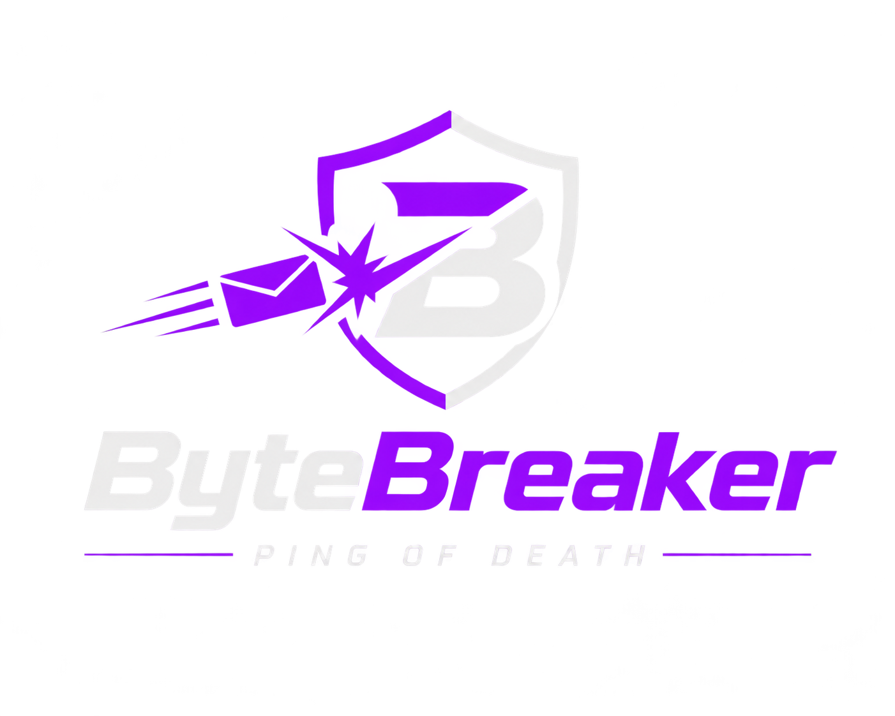

 

  

  <strong>Network Programming & Security Research</strong>

  <em>Explore Network Systems. Understand Security. Build Responsibly.</em>

  Python · Networking · Research · Open Source

---

## Overview

**ByteBreaker** is an experimental Python-based networking project focused on exploring low-level network communication, packet structures, and concurrent programming.

Built using Python's standard libraries, the project demonstrates fundamental networking concepts and the interaction between network protocols, system resources, and concurrent execution.

## Core Technologies

| Technology | Description |
|---|---|
| Python | Core programming language |
| Socket Programming | Network communication |
| ICMP & UDP | Network protocols |
| Multithreading | Concurrent execution |
| Multiprocessing | Parallel processing |
| Struct | Binary data structures |
| Argparse | Command-line interface |
| CSV | Statistics and reporting |

## Key Features

- **Network Protocol Research** — Experimental ICMP and UDP networking functionality.
- **Concurrent Architecture** — Multithreading and multiprocessing.
- **Packet Structures** — Binary packet construction and checksums.
- **Runtime Statistics** — Packet counters and traffic measurements.
- **CSV Reporting** — Export runtime statistics.
- **Input Validation** — Target and configuration validation.
- **Worker Management** — Automatic worker recovery mechanisms.
- **System Integration** — CPU affinity and network interface binding.

## Educational Objectives

ByteBreaker explores practical concepts in:

- Computer networking fundamentals
- Python system programming
- Network protocol architecture
- Raw socket communication
- Concurrent programming
- Process management
- Responsible security research

## Responsible Use & Security

**Important:** ByteBreaker contains experimental high-volume ICMP and UDP packet transmission functionality.

This software must only be used in isolated laboratory environments with explicit authorization.

- Never target public servers or third-party infrastructure.
- Never disrupt network availability or services.
- Do not use this project for unauthorized denial-of-service activity.
- Ensure all experiments remain within controlled and authorized environments.

Users are responsible for complying with applicable laws and network policies.

## Project Status

**Experimental Research Project**

ByteBreaker is provided for educational and research purposes. It has not been independently security-audited or approved for production deployment.

## Credits

Developed under the **ethical-tool** security research identity.

  <strong>ETHICAL-TOOL</strong>
   
  Learn. Research. Build. Secure.

